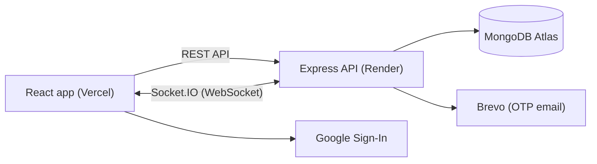

# 💬 Real-time Chat App

A full-stack real-time messaging app built with the **MERN stack + Socket.IO**.
Messages reach the other person instantly — no refresh needed.

🔗 **Live:** https://realtime-chat-app-wheat-beta.vercel.app


> ⏳ The backend runs on Render's free plan, so the **first request can take ~50 seconds** while the server wakes up. After that it's fast.

---

## 🧪 Try it

Sign in with **Google**, or create an account with your email (you'll receive a 6-digit OTP).
To see real-time messaging, log in with two accounts — one in a normal window and one in an incognito window — open each other's chat and send a message.

---

## ✨ Features

- ⚡ **Real-time 1:1 messaging** with Socket.IO — instant delivery, multi-device sync, duplicate-free
- 🔐 **Authentication** — JWT, bcrypt-hashed passwords, **email OTP verification**, forgot / reset password
- 🔵 **Google Sign-In**
- 🛡️ **Security** — Helmet, rate limiting, Zod validation (blocks NoSQL injection), central error handling
- 🔌 **Secured sockets** — JWT verified during the Socket.IO handshake, one private room per user
- 📱 **Responsive UI** — works on desktop and mobile

## 🧠 Engineering Highlights

- **REST for writes, sockets for notifications** — messages are saved through a validated, rate-limited REST API; Socket.IO only pushes the *saved* message. The database stays the source of truth, so offline users never lose messages.
- **Authenticated WebSockets** — the JWT is verified in Socket.IO middleware during the handshake, and each user joins a private room named after their user ID, so every device they are logged in on receives new messages.
- **Duplicate-free rendering** — the sender receives their own message twice (HTTP response + socket event); the client de-duplicates by message `_id`, so it appears exactly once.
- **Race-condition-safe chat switching** — an `ignore` flag in the `useEffect` cleanup discards late responses when the user switches chats quickly, so one person's messages never show up in another person's chat.
- **OTP & auth security** — OTPs are hashed, auto-expire with a MongoDB TTL index, allow limited attempts and have a resend cooldown; login returns the same error for a wrong email or wrong password (no user enumeration); resetting a password invalidates old tokens.
- **Production-ready deployment** — `trust proxy` for real client IPs behind Render's proxy (correct rate limiting), SPA rewrites on Vercel, and one CORS allowlist shared by Express and Socket.IO.
- **Indexed queries** — a compound index on `{ sender, receiver, createdAt }` keeps loading a conversation's latest 50 messages fast.

## 🛠️ Tech Stack

| Layer | Tech |
|---|---|
| Frontend | React (Vite), React Router, Tailwind CSS, Socket.IO client |
| Backend | Node.js, Express, Socket.IO |
| Database | MongoDB Atlas, Mongoose |
| Auth | JWT, bcrypt, Google Identity Services, Brevo (OTP emails) |
| Security | Helmet, express-rate-limit, Zod |
| Deployment | Vercel (client), Render (API), MongoDB Atlas (DB) |

## 🏗️ How it works



**Sending a message:**
1. The client sends `POST /api/messages` (JWT protected, Zod validated).
2. The server saves the message in MongoDB.
3. The server emits `message:new` to the **receiver's room** and the **sender's room** (for their other devices).
4. The receiver's open chat shows the message instantly. Offline users get it from the database when they open the chat.

## 🔌 API

| Method | Endpoint | Auth | Description |
|---|---|---|---|
| POST | `/api/auth/register` | — | Create account and send OTP |
| POST | `/api/auth/verify-otp` | — | Verify email OTP, returns JWT |
| POST | `/api/auth/login` | — | Email + password login |
| POST | `/api/auth/resend-otp` | — | Resend OTP (with cooldown) |
| POST | `/api/auth/forgot-password` | — | Send password-reset OTP |
| POST | `/api/auth/reset-password` | — | Reset password with OTP |
| POST | `/api/auth/google` | — | Sign in with Google |
| GET | `/api/users` | JWT | List verified users |
| GET | `/api/messages/:userId` | JWT | Latest 50 messages with a user |
| POST | `/api/messages` | JWT | Send a message |

All `/api/auth` routes are rate-limited.

**Socket.IO**

| Event | Direction | Description |
|---|---|---|
| connection (`auth: { token }`) | client → server | Connect with JWT; joins the user's private room |
| `message:new` | server → client | A new message for this user |

## 📁 Project Structure

```
chat-app/
├── client/          # React app (Vite + Tailwind)
│   └── src/
│       ├── components/   # Sidebar, ChatWindow, route guards
│       ├── context/      # AuthContext, SocketContext
│       ├── pages/        # Login, Register, Verify OTP, Chat, Privacy...
│       └── lib/api.js    # fetch helper
└── server/          # Express + Socket.IO API
    └── src/
        ├── controllers/  # auth, users, messages
        ├── middleware/   # JWT guard, rate limit, validation, errors
        ├── models/       # User, Otp, Message
        ├── routes/
        ├── socket/       # Socket.IO setup + auth
        └── validators/   # Zod schemas
```

## 🚀 Run Locally

```bash
git clone https://github.com/kapil-2025/realtime-chat-app.git
cd realtime-chat-app
```

**Server** — create `server/.env`:
```
PORT=5000
MONGO_URI=
JWT_SECRET=
BREVO_API_KEY=
EMAIL_FROM=
EMAIL_FROM_NAME=
GOOGLE_CLIENT_ID=
CLIENT_URL=http://localhost:5173
```
```bash
cd server
npm install
npm run dev
```

**Client** — create `client/.env`:
```
VITE_API_URL=http://localhost:5000
VITE_GOOGLE_CLIENT_ID=
```
```bash
cd client
npm install
npm run dev
```

## 🗺️ Roadmap (in progress)

- [ ] Unread message counts + last message preview in the sidebar
- [ ] Online / offline status + last seen
- [ ] Read receipts (✓ / ✓✓)
- [ ] Typing indicator
- [ ] Profile photo + block users
- [ ] Image sharing, group chats, audio/video calls

## 👤 Author

**Kapil Gupta** — [GitHub](https://github.com/kapil-2025)